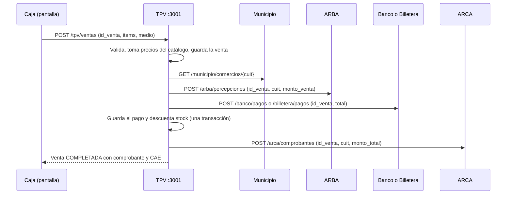

# TPV · Punto de venta de Brisa

Módulo **TPV** del Ecosistema Fintech simulado (ISFDyT N° 26). Es un punto de venta para cualquier rubro: cada comercio tiene su catálogo y el TPV coordina cada venta con los demás módulos por HTTP.

```
Municipio (habilitación) → ARBA (percepción IIBB) → Banco o Billetera (cobro) → ARCA (comprobante)
```

- **Puerto:** `3001`
- **Stack:** C# / ASP.NET Core 8 (minimal API) + SQLite (un archivo, sin servidor aparte)
- **Pantallas:** HTML + CSS + JavaScript sin dependencias, servidas por la misma app en `http://localhost:3001`
- **Autora:** Brisa. Implementación independiente de la app TPV de Sebastián, que no se modifica.

---

## Cómo ejecutarlo

### Opción A: Docker (recomendada)

Requiere Docker Desktop.

```bash
docker compose up --build
```

Abrir **http://localhost:3001**.

Este `docker-compose.yml` levanta dos contenedores:

| Contenedor | Para qué |
|---|---|
| `tpv` | El TPV. Es el mismo `Dockerfile` que se usa en la integración del curso. |
| `simuladores` | Dobles de prueba de Municipio, ARBA, Banco, Billetera y ARCA con datos ficticios, para mostrar una venta completa sin depender de los otros equipos. **No forman parte de la entrega integrada.** |

Para apagar: `docker compose down` (agregar `-v` para borrar también la base).

### Opción B: Visual Studio

1. Abrir `TpvBrisa.sln`.
2. Clic derecho en la solución → **Configurar proyectos de inicio** → **Varios proyectos de inicio** → marcar `Tpv.Api` y `Simuladores` como **Iniciar**.
3. F5. Se abre el navegador en `http://localhost:3001`.

Sin Visual Studio: `dotnet run --project herramientas/Simuladores` en una terminal y `dotnet run --project src/Tpv.Api` en otra.

### Integración con el ecosistema

Para la prueba conjunta se usa solo el `Dockerfile` de esta carpeta, y se configuran las URLs con el nombre de servicio de cada módulo dentro de Compose (no `localhost`):

```yaml
tpv:
  build: ./alumnos/brisa
  ports: ["3001:3001"]
  environment:
    MUNICIPIO_URL: http://municipio:3005
    ARBA_URL: http://arba:3003
    BANCO_URL: http://banco:3002
    BILLETERA_URL: http://billetera:3006
    ARCA_URL: http://arca:3004
  volumes: ["tpv-datos:/app/data"]
```

Si se levanta junto al TPV de Sebastián en la misma máquina, cambiar el puerto del host (por ejemplo `"3011:3001"`). Adentro del contenedor sigue siendo 3001.

---

## Variables de entorno

| Variable | Valor por defecto | Descripción |
|---|---|---|
| `PORT` | `3001` | Puerto HTTP del TPV |
| `DB_PATH` | `data/tpv.db` (`/app/data/tpv.db` en Docker) | Archivo SQLite propio |
| `MUNICIPIO_URL` | — | Base de Municipio, p. ej. `http://municipio:3005` |
| `ARBA_URL` | — | Base de ARBA, p. ej. `http://arba:3003` |
| `BANCO_URL` | — | Base de Banco, p. ej. `http://banco:3002` |
| `BILLETERA_URL` | — | Base de Billetera, p. ej. `http://billetera:3006` |
| `ARCA_URL` | — | Base de ARCA, p. ej. `http://arca:3004` |
| `HTTP_TIMEOUT_MS` | `5000` | Espera máxima por llamada a otro servicio |
| `TIPO_COMPROBANTE` | `FACTURA_B` | Tipo que se pide a ARCA |

Si falta una URL, la etapa que la necesita queda **PENDIENTE** con un mensaje claro. Nunca se simula un éxito. Ver `.env.example`.

---

## API

Contrato común: JSON en `snake_case`, CUIT como string de 11 dígitos, dinero en pesos con hasta 2 decimales (internamente se guardan centavos), fechas ISO 8601 UTC y errores siempre como `{"error":"mensaje"}`.

| Método | Ruta | Descripción |
|---|---|---|
| GET | `/health` | `{"status":"ok","servicio":"tpv"}` |
| POST | `/tpv/ventas` | Registra y coordina una venta (idempotente por `id_venta`) |
| GET | `/tpv/ventas/{id}` | Venta con estado, líneas, subtotal, percepción, total, pago y comprobante |
| GET | `/tpv/ventas` | Historial. Filtros: `estado`, `comercio_cuit`, `desde`/`hasta` (YYYY-MM-DD), `q`, `limit` |
| GET | `/tpv/productos` | Catálogo. Filtros: `comercio_cuit`, `q`, `incluir_inactivos=true` |
| GET | `/tpv/productos/{id}` | Un producto |
| POST | `/tpv/productos` | Alta: `comercio_cuit`, `nombre`, `categoria`, `precio`, `stock` |
| PUT | `/tpv/productos/{id}` | Modificación parcial (incluye `activo`) |
| GET | `/tpv/comercios` · `/tpv/comercios/{cuit}` | Comercios del TPV |
| POST | `/tpv/comercios` | Alta: `cuit`, `razon_social`, `rubro`, `cuenta_destino` |
| PUT | `/tpv/comercios/{cuit}` | Modificación parcial |
| GET | `/tpv/integraciones` | Qué servicios responden (sin exponer URLs) |

### POST /tpv/ventas

**Con Banco**

```json
{
  "id_venta": "venta-2026-00042",
  "comercio_cuit": "30712345678",
  "items": [{ "producto_id": "prod-1", "cantidad": 2 }],
  "medio_pago": "banco",
  "cuenta_origen": "cuenta-cliente-1"
}
```

**Con Billetera:** igual, pero con `"medio_pago": "billetera"` y `"cuit_pagador": "27123456789"` en lugar de `cuenta_origen`. Se acepta uno solo de los dos datos de pago.

El pedido **no** lleva precios ni totales: el TPV los toma de su catálogo.

**201 Created** (venta nueva completa) · **200 OK** (repetición idéntica de una venta ya completada o reintento que la completa):

```json
{
  "id_venta": "venta-2026-00042",
  "comercio_cuit": "30712345678",
  "razon_social": "Almacén de la Feria",
  "estado": "COMPLETADA",
  "etapa": "comprobante_emitido",
  "etapa_pendiente": null,
  "ultimo_error": null,
  "intentos": 1,
  "lineas": [
    { "producto_id": "prod-1", "nombre": "Alfajor de maicena", "precio_unitario": 1200.00, "cantidad": 2, "subtotal": 2400.00 }
  ],
  "subtotal": 2400.00,
  "alicuota_percepcion": 0.03,
  "percepcion": 72.00,
  "total": 2472.00,
  "percepcion_id": "percepcion-0001",
  "pago": { "medio": "banco", "cuenta_origen": "cuenta-cliente-1", "cuit_pagador": null, "id_movimiento": "mov-0002", "estado": "confirmado" },
  "comprobante": { "id": "comprobante-0001", "numero_comprobante": "00001-00000001", "tipo_comprobante": "FACTURA_B", "cae": "FICTICIO-…", "fecha_emision": "2026-10-28T14:25:00.000Z" },
  "creada": "2026-10-28T14:25:00.000Z",
  "actualizada": "2026-10-28T14:25:00.120Z"
}
```

**Errores**

| Código | Cuándo | ¿Se guarda la venta? |
|---|---|---|
| 400 | Datos inválidos (CUIT, cantidades, medio de pago, stock) | No |
| 404 | Comercio o producto inexistente en el TPV | No |
| 409 | El mismo `id_venta` con otro contenido | No |
| 400 | Un servicio rechazó la operación (comercio no habilitado, saldo insuficiente…) → `ERROR` | Sí |
| 503 | Un servicio no respondió o devolvió 5xx → `PENDIENTE` | Sí |

Cuando la venta quedó guardada pero incompleta, la respuesta mantiene el formato común y agrega lo necesario para consultarla o reintentarla:

```json
{ "error": "ARCA no respondió a tiempo", "id_venta": "venta-2026-00042", "estado": "PENDIENTE", "etapa_pendiente": "comprobante_emitido" }
```

---

## Flujo, estados y recuperación



- Después de cada etapa se guarda su resultado y el identificador externo (`percepcion_id`, `id_movimiento`, comprobante) **antes** de pasar a la siguiente.
- Estados: `PENDIENTE` (un servicio no respondió), `ERROR` (un servicio rechazó) y `COMPLETADA`. Los dos primeros se pueden reintentar.
- **Reintento:** se repite el mismo `POST` con el mismo `id_venta`. El TPV saltea las etapas confirmadas y sigue desde `etapa_pendiente`. Nunca vuelve a cobrar un pago confirmado.
- Se usa **un solo medio de pago** por venta.
- No hay *fallbacks*: si ARBA, el pago o ARCA no responden, no se inventan percepción, pago ni CAE.

### Caso reproducible de fallo parcial

Con `docker compose up`, los pasos 7a a 7f de `pruebas/tpv.http` (o con curl):

```bash
# ARCA "se cae"
curl -X POST localhost:3099/_simulador/caidas -H "Content-Type: application/json" -d '{"servicio":"arca","caido":true}'

# Venta → 503 PENDIENTE, etapa_pendiente = comprobante_emitido (el pago SÍ quedó confirmado)
curl -X POST localhost:3001/tpv/ventas -H "Content-Type: application/json" \
  -d '{"id_venta":"demo-fallo-1","comercio_cuit":"30712345678","items":[{"producto_id":"prod-4","cantidad":1}],"medio_pago":"banco","cuenta_origen":"cuenta-cliente-1"}'

# ARCA vuelve y se reintenta con la misma clave → 200 COMPLETADA, intentos = 2
curl -X POST localhost:3099/_simulador/caidas -H "Content-Type: application/json" -d '{"servicio":"arca","caido":false}'
curl -X POST localhost:3001/tpv/ventas -H "Content-Type: application/json" \
  -d '{"id_venta":"demo-fallo-1","comercio_cuit":"30712345678","items":[{"producto_id":"prod-4","cantidad":1}],"medio_pago":"banco","cuenta_origen":"cuenta-cliente-1"}'

# El Banco registró un solo pago
curl localhost:3099/_simulador/estado
```

En la pantalla se ve igual: la venta queda “Pendiente”, con el recorrido marcado, y el botón **Reintentar cobro** la completa.

---

## Pruebas

```bash
dotnet test
```

Son 16 pruebas de integración (`tests/Tpv.Api.Tests`) que levantan el TPV y los simuladores en memoria. Cubren:

- venta completa con Banco y con Billetera;
- importes calculados con el catálogo;
- repetición idempotente (200 sin cobrar de nuevo);
- misma clave con otros datos (409);
- datos inválidos (400 con `{"error"}`);
- producto inexistente o de otro comercio (404);
- ARCA caída → PENDIENTE → reintento que no vuelve a cobrar;
- saldo insuficiente (ERROR sin tocar el stock);
- descuento de stock.

Para probar a mano: `pruebas/tpv.http` (se abre en Visual Studio).

### Prueba con los módulos reales del repo (27/10/2026)

Se ejecutó el TPV contra el código de `main` de **Municipio** (Cristian), **ARBA** (Nehemias), **Banco** (Rodrigo) y **Billetera** (Lucas-M):

- venta con Banco y venta con Billetera completas (201);
- comercio no registrado en Municipio rechazado (400, `ERROR`).

ARCA se probó con el simulador (ver la nota siguiente).

---

## Notas de compatibilidad con los módulos actuales

El TPV respeta la guía fundacional y tolera algunas diferencias de los módulos de `main` sin cambiar el contrato. Estas son las diferencias encontradas, para que cada equipo las tenga en cuenta:

| Módulo | Diferencia con la guía | Efecto en el TPV |
|---|---|---|
| Banco (Rodrigo) | Responde `{success, data, errors}` y no deduplica por `id_venta` | El TPV desenvuelve `data` y lee `errors[0].message`. Un reintento después de un timeout del Banco podría duplicar el débito del lado del Banco. |
| Banco (Rodrigo) | Las cuentas tienen ids numéricos (`1`, `2`…) | `cuenta_origen` y la `cuenta_destino` del comercio se cargan como `"1"`, `"2"`, etc. |
| Billetera (Lucas-M) | `monto` tiene que ser entero, responde la billetera (no el movimiento) y no deduplica por `id_venta` | Totales con centavos (frecuentes por la percepción) son rechazados con 400 → la venta queda `ERROR`. |
| ARCA (Keving/Teo, ZIP) | `POST /arca/comprobantes` exige sesión iniciada (cookie) | Responde 401 → la venta queda `ERROR` en la etapa de comprobante hasta que ARCA ofrezca acceso entre servicios. |
| ARBA, Banco, Billetera | No exponen `GET /health` | Solo afecta al indicador de conexiones: el TPV los considera “en línea” si el servidor contesta. |

---

## Datos de prueba (ficticios)

| Comercio | CUIT | Rubro | Cuenta de cobro |
|---|---|---|---|
| Almacén de la Feria | 30712345678 | Alimentos | cuenta-comercio-9 |
| Librería Punto y Coma | 30722222225 | Librería | cuenta-comercio-2 |
| Ropero Urbano | 30733333336 | Indumentaria | cuenta-comercio-3 |

En los simuladores:

- **Banco:** `cuenta-cliente-1` ($ 500.000) y `cuenta-cliente-2` ($ 2.000, para probar saldo insuficiente).
- **Billetera:** CUIT `27123456789` ($ 250.000) y `20111111112` ($ 1.500).

---

## Estructura

```
alumnos/brisa/
├── TpvBrisa.sln
├── Dockerfile               ← imagen del TPV (la que se integra)
├── docker-compose.yml       ← demo local: TPV + simuladores
├── .env.example
├── src/Tpv.Api/
│   ├── Program.cs           ← arranque, errores {"error"}, archivos estáticos
│   ├── Api/                 ← endpoints y formato de respuestas
│   ├── Ventas/              ← CoordinadorVentas: etapas, estados y reintentos
│   ├── Integraciones/       ← cliente HTTP con timeout para los otros módulos
│   ├── Datos/               ← SQLite: esquema, repositorio y datos de ejemplo
│   ├── Dominio/             ← modelos, dinero en centavos y validaciones
│   └── wwwroot/             ← pantallas: vender, ventas, productos y comercios
├── herramientas/Simuladores/  ← dobles de prueba (solo desarrollo y demo)
├── tests/Tpv.Api.Tests/       ← pruebas de integración (xUnit)
└── pruebas/tpv.http           ← requests listos para Visual Studio
```
